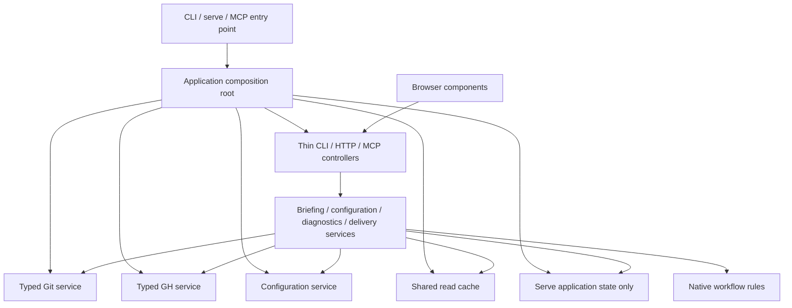

# Typed Git/GH services, controllers and application composition

Owner decisions, 2026-11-17: audit #868, GH service foundation #869,
PDB serve composition #870, and application state #816. This is a
contract amendment, not runtime delivery. Existing CLI/MCP/HTTP interfaces,
workflow rules, configuration semantics and recovery guarantees remain in force.

## Application-facing GH service

Application callers use typed asynchronous capabilities for GitHub operations,
not a raw command/API proxy. Group capabilities by purpose: account/context,
issues, pull requests/reviews, dependencies and workflow writes. Exact method
catalogues come from #868's call-site inventory; the audit records inputs,
required fields, pagination and preserved behavior rather than inventing one
universal GitHub object. Reuse existing domain types and error classes where
accurate. A method may combine high-level GH commands with REST or GraphQL;
that choice stays inside its implementation.

The low-level argument-array runner remains an internal, injectable transport.
It owns direct process execution without a shell, explicit execution context,
AbortSignal/deadline handling, bounded output and factual attempt diagnostics.
Distinguish spawn failure, nonzero exit, timeout and cancellation. Do not expose
credentials, private request bodies or unrestricted subprocess stderr in normal
application results. Capability adapters validate responses into typed results;
a TypeScript cast alone is not response validation. Preserve absent/unknown and
partial data rather than manufacturing complete empty results.

A factory receives the transport, clocks and existing shared boundaries. No
process-global selected repository, account or agent may leak between callers.
Repository/host/account context is explicit or resolved by the existing documented
CLI/server selection rules. Continue using authenticated `gh`; do not introduce
new credentials, a competing HTTP client or browser-to-GitHub calls.

The service supplies facts and operations. Native rules remain the source of
workflow eligibility, ordering, ownership and admission decisions. Domain reads,
mutation planning/recovery and presentation do not move into a command runner.

## Typed results and shared caching

Return the smallest existing/proposed typed domain result sufficient for callers.
Preserve current schema versions and transport adapters. Carry or retain access to
observed-at, freshness, coverage/completeness, omissions and error provenance at
the read-service result boundary. Raw JSON is parsed inside the capability; an
opaque passthrough dictionary is not the normal application-facing contract.

A shared read-service/cache adapter may wrap capabilities. Reuse the current
bounded cache, in-flight joining, cancellation ownership and explicit-refresh
machinery; do not stack a second independent cache under already cached reads.
The transport runner itself does not decide freshness or cache workflow policy.
Key results by verified host/account/repository plus capability arguments and
required coverage; never reuse another identity/project's facts. Preserve current
TTL, stale-on-failure and authentication/refusal rules rather than choosing new
values in this refactor. An explicit fresh read cannot silently return stale
facts. Cache provenance must describe the actual observation, not retrieval time.

Mutations are never cached and are not retried blindly. Preserve the existing
comment/write recovery boundary, receipts and uncertain-outcome handling.
Invalidate affected cached facts after confirmed changes; uncertain outcomes
must prevent affected cached data from being presented as confirmed current.
Define invalidation membership in each migrated capability, conservatively when
necessary. No background polling or prefetch is introduced by service creation.

## Composition versus state

PDB serve's application composition service/factory (#870) creates and connects
configuration, application state, existing GH adapters, read services, cache and
HTTP/MCP/lifecycle dependencies. Keep an explicit typed dependency graph rather
than a service locator or new dependency-injection framework. Construction should
not fetch issues or create agent identities as an incidental side effect.
Startup operations retain their existing explicit preparation and authentication.

The configuration service remains independent: read/list/set, validation, safe
writes, revision and factual diffs. The CLI calls it directly. The application
state service (#816) is serve-only: it tracks initial/running, saved and applied
configuration, computes live/restart consequences and explains them. It does not
construct unrelated services. Composition instantiates it, and the Configuration
API/page displays its results. Do not persist a restart dirty bit; returning a
restart-only setting to its running value removes the derived restart reason.

Composition owns startup and shutdown sequencing. Partial startup releases only
resources it actually acquired. Shutdown is bounded and idempotent, respects
in-flight request/subprocess/MCP cancellation, and does not kill another running
instance. Preserve existing Host/Origin/CSP controls; new security infrastructure
remains deferred. The extraction does not change normal `pdb serve` or mandate
application composition for short-lived CLI config operations.

## Accepted Git implementation and script exception

Owner acceptance, 2026-11-18: use the installed Git executable behind a typed Git
service, retaining the existing injectable runner internally. No new Git library
is selected now. Research #872 / PR #895 inventories the current operations and
records why this is the initial choice; a later library change needs its own
evidence and contract, not a caller rewrite.

Expose only needed typed operations: checkout/common directory, remotes,
revision/ref identity, divergence, ignored/tracked status and Git-owned paths.
Validate and interpret command output inside this boundary. Distinguish absence
from execution failure and unknown evidence; preserve cancellation and explicit
checkout context. Existing GitRunner injection remains an adapter/test seam,
not the target application-facing API. Never let GH_REPO silently change the
identity of a selected checkout. Compose repository-context features from typed
Git/GH facts without circular service dependencies.

Every main PDB command and subcommand, and its CLI/MCP/HTTP feature modules,
uses the typed Git and GH services. Only their private transport/adapter modules
may execute the utilities or build raw executable arguments. Callers do not use
arbitrary GitRunner/query/argv escape hatches as the final interface. Existing
bypasses are tracked migration debt, not precedent for new direct calls. Shared
services must remain usable directly without HTTP loopback.

The owner explicitly excepted release scripts and standalone tooling from the
**Git** migration. Such scripts may continue direct Git invocation with their
current safeguards; do not migrate scripts/dispatch.ts or alter its ancestry,
credential or non-forced-push behavior in this program. This is not an exception
for a helper imported/invoked as part of the main PDB program merely because its
file lives in scripts/. Tests may inject fakes or use disposable Git fixtures;
printed examples and user-run recovery commands are not utility execution sites.
Keep the audit's standalone GH tooling exclusions explicit rather than broadening
them to application modules.

## Controllers and construction scope

One application composition root constructs **one Git service and one GH service
per application lifetime**, and shares them with feature services/controllers.
For a CLI invocation that lifetime is the invocation; for serve/MCP it is the
running process/application. This is not one singleton across all processes and
not a global mutable selected checkout/account/agent. Per-request context remains
explicit and cached observations remain context-partitioned.

The browser arrow denotes HTTP API controllers, not CLI/MCP or direct utility
access. Controllers validate transport input, call feature services, and project
results/errors; they do not construct Git/GH clients, parse utility output or
implement workflow policy. Feature services coordinate domain operations and
native-rule decisions, using shared typed dependencies.

The application service owns wiring and bounded startup/shutdown, not every
feature's domain behavior. The serve-only state service tracks saved/running/applied
configuration and restart consequences; it is not the composition container.
Config CLI operations still call configuration directly, without requiring serve
state or an HTTP server. Pure service construction must not issue GitHub reads,
allocate identities, watch files or prefetch tickets. Short-lived reads/help do
not acquire unrelated long-running resources. Join/cancel shared reads using
existing cache semantics so one request does not cancel another consumer.

## Module-sized migration rule

The owner requested one bounded migration per application module wherever
practical. A module using both Git and GH has one ticket covering both interfaces.
Inventory each call site, required typed methods, changed injection types and
focused behavioral tests. A very large module may be split by its existing
responsibility boundaries, named explicitly; do not create duplicate competing
module edits or one repository-wide implementation PR.

Use #868's GH audit and #872's Git inventory to maintain an exact module-to-ticket
map. Existing broad capability tickets become coordination umbrellas when split,
retaining active claims/PRs and original acceptance. Add real prerequisite edges
for the service capabilities each module needs. The Git/GH foundations can ship
incrementally; preserve compatibility adapters while callers migrate, but do not
call a module migrated while it still supplies raw utility commands or parses
raw transport JSON. Remove obsolete wrappers only after the last mapped caller
moves. Release/standalone scripts are recorded exclusions, not migration tickets.

## Delivery order and focused acceptance

1. #868 produces a concise inventory of modules, direct/indirect GH touchpoints,
   underlying API operations, proposed typed capability methods and caching needs.
   Update it for mixed high-/low-level commands; one CLI command need not equal one
   endpoint. The audit does not implement the service or every migration.
2. #869 supplies the shared injectable transport/factory and initial typed account
   and repository-context capabilities, preserving current wrapper behavior.
   The audit must confirm the initial surface before implementation; remaining
   methods/callers become small follow-on migration tickets, grouped by behavior.
3. Each migration names callers, typed inputs/results, response validation,
   pagination/completeness, cancellation, errors, cache/invalidation and recovery
   checks. Preserve existing injection seams with adapters while consumers migrate.
   Converge on one execution boundary; do not maintain two competing implementations.
4. #870 extracts composition independently using existing adapters. It need not
   wait for every GH migration, and #816 need not wait for this structural cleanup.

Use injected transport/clock/filesystem/configuration boundaries. Focus tests on
literal arguments, context isolation, abort/deadline/error classification, typed
response validation, cache freshness/invalidation and partial-start cleanup.
Retain existing workflow/native tests without cloning their matrix into each
capability. One packed CLI/MCP/serve smoke proves integration outside the checkout.
The docs amendment itself requires formatting only. Implementation tickets remain
open until their own runtime acceptance is delivered.

## Module delivery index

The [application module migration map](git-gh-module-migrations.md) records exact
module ownership, Git/GH needs, estimates, native prerequisites and exclusions.
Use it instead of picking a broad capability umbrella for duplicate work.

## General shared-capability guardrail

The [main architecture guidelines](../architecture.md)
apply this architecture beyond Git/GH: one canonical capability owner, explicit
scoped state-holders for retained mutable state, injected composition and no new
consumer bypasses. Existing narrow script exceptions remain unchanged.
