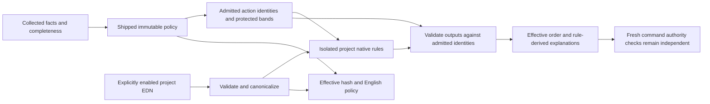

# Native per-project rules over immutable defaults (#499)

Research by farhad_taphrale in Codex, 15 November 2026, source main `7f448e6`.
No production loader, repository/host setting, GitHub mutation or model trial was
used in the probe. This report proposes a design for the unfinished part of #75;
it does not claim arbitrary user Datalog programs are safe.

## Current boundaries and observed probe

The shipped engine accepts a normalized fact set and a trusted `PolicyOptions.policy`
bundle. The latter exists for isolated native tests; it is not an untrusted file
interface. `build.ts:validateBundle` validates forms, references, shapes, ordering,
witnesses and English coverage, but does not freeze the intended semantics of an
existing predicate. Runtime cancellation checks are between synchronous queries:
an AbortSignal alone cannot preempt a long-running `ds.q` call. Current subject and
datom limits are valuable input bounds, not a wall-clock or recursion sandbox.

Run from a development checkout:

```text
npx tsx doc/reports/examples/native-project-overrides.ts
```

The credential-free probe uses the real shipped engine, build validator, DataScript,
EDN reader/printer and English compiler. The independent fixture is native EDN at
`doc/reports/fixtures/project-priority.edn`, not TypeScript-embedded rule source.

| Experiment                                                                    | Observed result                                                                                         |
| ----------------------------------------------------------------------------- | ------------------------------------------------------------------------------------------------------- |
| Default policy on five synthetic issues                                       | Only subjects 100 and 104 produced implement actions                                                    |
| Append an alternate `eligible` rule, then validate/evaluate that whole bundle | Subjects 101 (other owner), 102 (incomplete labels), 103 (open blocker) also produced implement actions |
| Native project rule matches label `project:priority` and derives 10           | DataScript returned the intended priority fact for 104                                                  |
| Apply proposed exact subject/action-kind admission to project output          | 104 moved ahead of 100; forged implement actions for 101/102/103 and forged merge kind were rejected    |
| Compile the project predicate with the current English compiler               | `?t has label "project:priority" and ?score = 0 + 10`                                                   |
| Canonicalize EDN and hash                                                     | A comment/layout change preserved the digest; changing 10 to 11 changed it                              |

The unsafe whole-bundle experiment demonstrates why namespace validation alone is
insufficient and why no production path should accept a project file through the
trusted test option. The admission sketch is intentionally small: it proves exact
candidate intersection for this fixture, not a production parser, security proof,
full recursion analysis, worker timeout or complete effective-English renderer.
The English text above describes the derived condition; it is not a model-written
explanation and does not invent the product value of a label.

## Recommended first native override delivery

Keep immutable safety/authority and project preference as separate evaluation
stages. The requested file must contain genuine DataScript EDN rules, conditions,
metadata and reason bindings; do not replace it with a few TOML priority settings.
Use the existing parser/compiler and editor-friendly EDN representation.



Project rules can change priority/reasons for registered already-admitted actions.
They cannot create a claim/merge action for a denied subject, change its action kind,
assert missing facts complete, replace a collector input, remove a responsibility,
remove a safety denial or alter a mutation command's permission/completion checks.
Key admission by repository + subject + action kind + role, not subject alone. The
probe deliberately attacks a kind change on an otherwise permitted subject.

For the first slice preserve protected addressed-attention and concrete selected-PR
follow-up bands. Allow native project preference keys within other registered
bands, with stable default tie-breaks and original selection/oldest/newest semantics
reported. This is a bounded native priority override, not arbitrary replacement of
the entire workflow. Broader cross-band or new-action extensions need a separate
reviewed contract and must not be silently claimed shipped by #75. Explain this
limitation in help and the effective rules page.

Keep all admitted default obligations even when the project emits no row; absent
project preference means default order/reason, not deletion. Duplicate/conflicting
project keys, nonfinite/out-of-range outputs, unknown action IDs/kinds or false
claims of authority invalidate the override evaluation instead of partially applying
an attack. Reasons are bounded declarative templates whose placeholders bind
actual matched facts, clearly labeled with project rule IDs. They supplement rather
than erase required default safety/waiting warnings. No free-form LLM narrator.

## Source, configuration and validation proposal

Use a committed project-root `pdb.rules.edn` with an explicit format version and
base-policy compatibility range/hash. A private project setting explicitly enables
it through `pdb config`; file presence alone does not activate downloaded repository
code. Program-mediated `pdb rules init` can generate a reviewable starter file and
show the enable command; it must not overwrite an existing file or silently enable
rules. Final CLI spelling/registered setting help is implementation design, not a
claim those commands exist today. No global override of arbitrary checked-out repos.

Resolve the file from the verified selected checkout, not the server's launch cwd
or first registered project. HTTP requests selecting only a remote repo cannot
name arbitrary local paths; use an explicitly registered verified project root.
No environment interpolation, remote imports, symlink escape, external includes or
host-language eval. Read one local bounded file and preserve its provenance.

Reject unknown top-level keys and unsupported versions before evaluation. Proposed
initial limits: 64 KiB source, 100 rule alternatives, 1,000 clauses, nesting depth 20,
no rule cycles/recursion and a bounded whitelist of current native pure functions,
comparisons and joins. Require project-prefixed predicate/rule IDs and reject any
redefinition of shipped predicates, schema, constants, queries, lexicon or reserved
outputs. Permit label/assessment/dependency facts only through a documented read-only
projection, not policy entity IDs or synthetic authority facts. Literal attribute
names must use the shared lexicon; variable attributes remain explicit in English.

Those are proposed limits requiring representative fixture calibration, not measured
engine capacities. Validate syntax/size before transferring to a worker. Evaluate
project rules in a worker with a finite elapsed deadline and bounded heap/output;
terminate it on timeout/cancellation. A proposed 500 ms evaluation budget and
128 MiB JS heap limit need measured acceptance on supported platforms. Node worker
heap limits are not a guarantee of total process RSS. Cap input/result tuples and
join fan-out; fixture-test resource exhaustion rather than claiming the static
whitelist proves it impossible. No synchronous untrusted query on the server loop.

## Defaults, failure, hashes and English

Bundled defaults remain usable without a project file, outside checkouts and in new
repositories. Disabled overrides use those exact defaults. Missing, unreadable,
invalid, incompatible or timed-out _enabled_ overrides produce an explicit policy
error/incomplete result with safe disable/repair guidance, not an unnoticed fallback
that claims to honor the project's policy. A caller may explicitly choose the
unmodified default or TypeScript rollback as a separate visible configuration action.
No automatic configuration write, cache poisoning or last-good-policy activation.

Recompute effective identity over format version, shipped canonical policy/hash,
canonical project form, compatibility metadata and validated projection/schema
version. Report default hash, project hash and composite effective hash separately.
Whitespace/comments do not change semantics; matching conditions, reason bindings,
priority keys or constants do. Do not reuse only the default rules hash for a
changed project policy. Cache by verified repo/root, enablement, effective revision
and authority partition; invalidate compiled models/queues on policy change.

`pdb rules`, the web rules page, CLI/MCP diagnostics and rule-only tests must expose
the same effective policy. Compile default immutable rules plus project conditions,
priority effects, reason bindings and their explicit bounds into controlled English.
Show source IDs and protected/non-overridable sections. Do not present a default-only
English page as the project's effective rules. The probe demonstrates predicate
compilation; metadata/provenance and the combined renderer still require delivery.
Packaged consumers need the parser/validator/worker resources bundled deliberately;
they cannot depend on a source checkout or development-only `edn-data` by accident.

## Failure matrix and verification

| Case                                                                    | Required behavior                                                |
| ----------------------------------------------------------------------- | ---------------------------------------------------------------- |
| Defaults, no file, disabled setting                                     | Exact shipped default parity                                     |
| Valid native priority/reason match                                      | Changed ordering/reason with effective hash and evidence         |
| Remove/redefine eligible, ownership, permission or completion predicate | Reject before activation; immutable results retained             |
| Forge subject/action kind or completeness/authority facts               | Reject output or input shape; no executable authority            |
| Missing evidence or another owner                                       | Remains denied/inspection, never implementation by project rule  |
| Conflicting outputs, unsupported version/function, unknown lexicon      | Explicit policy error; no silent partial application             |
| Cyclic rule graph or excess source/clauses/depth                        | Static rejection                                                 |
| Bounded syntax with explosive joins, slow worker, memory/result excess  | Terminate and report error/incomplete; server remains responsive |
| Cancel or config/file changes during evaluation                         | Discard stale generation; no mutation or cross-repo reuse        |
| Same policy/layout-only edit versus semantic edit                       | Stable versus changed effective hash, respectively               |
| Wrong project/path, symlink escape, remote include                      | Refuse before reading/evaluating unselected content              |

Current probe enforces only its assertions: unsafe-bundle counterexample, native
priority match, exact candidate admission sketch, predicate English and canonical
hash comparison. Every other row is proposed acceptance, not observed protection.
Immutable fresh command checks must be tested independently even after a successful
ranking probe. Include native EDN rule tests and separate infrastructure/worker
failure reporting under the existing isolated-rules/JUnit contract.

## Implementation slices for #75

1. Review this boundary and finalize the native extension schema, registered setting
   and starter/config interface. Keep #75 as the integration parent; no owner answer
   is needed to inspect or validate this proposed limited first slice.
2. Implement strict local source loading, validation/canonical bundle identity and
   native schema tests. No activation before the complete evaluation boundary exists.
3. Implement isolated evaluation and immutable exact-action admission, protected-band
   preference integration, reasons and resource/cancellation tests together.
4. Integrate per-project config, CLI/MCP/server generation/cache identity and effective
   English output. Add installed-package tests with no network or source checkout.
5. Verify default parity and adversarial native fixtures; document the native subset
   and explicit rollback before enabling on an owner's real project.

A decision to allow arbitrary new workflow actions or unrestricted recursive/cross-
band policy is a future product/architecture choice, not a hidden extension of the
small loader. Do not close #75 solely because defaults or this research report ship.
